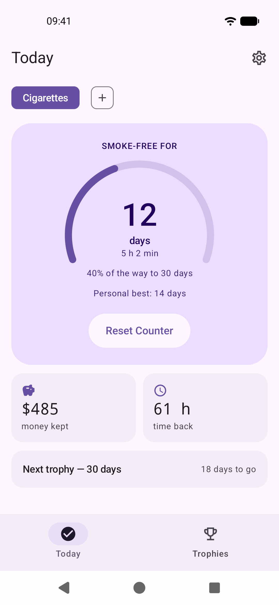
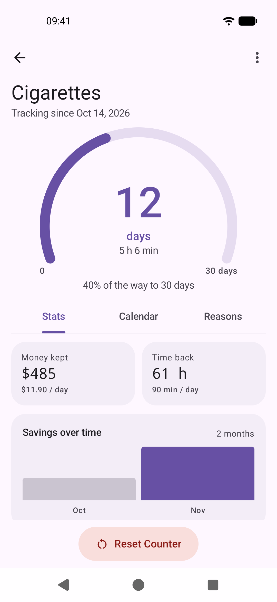
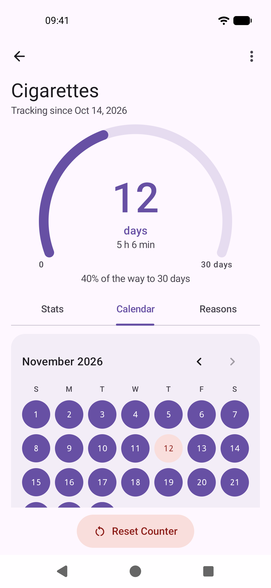
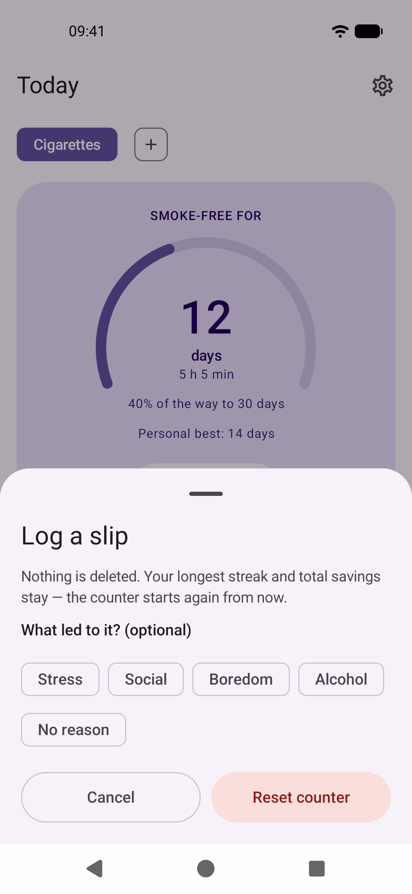
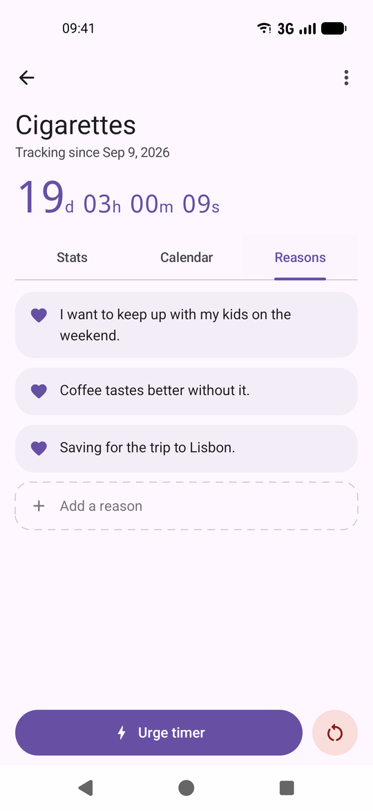
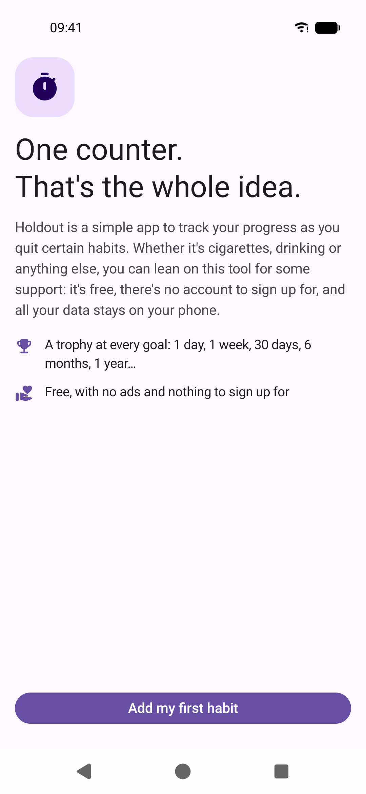
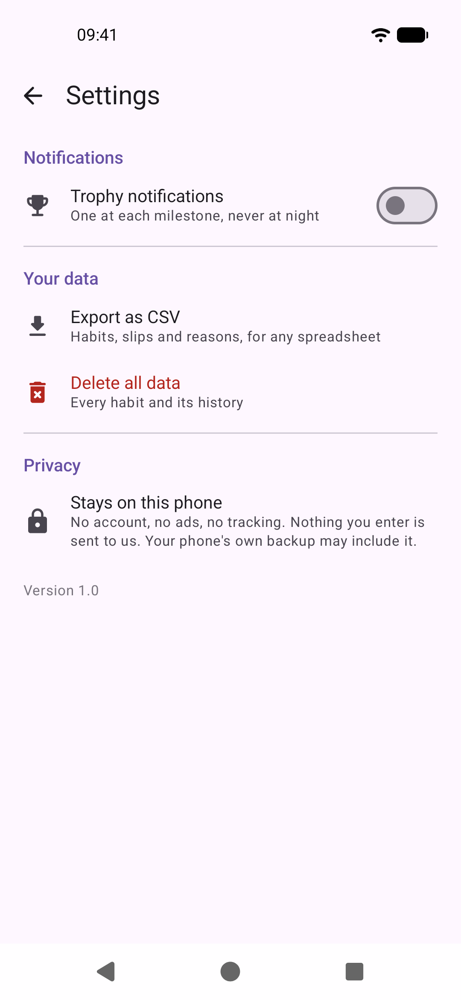
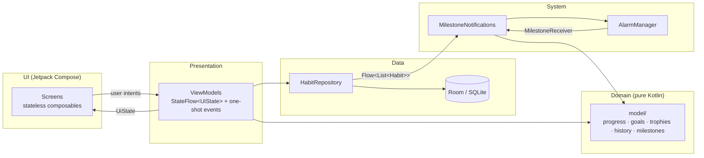

# Quitter for Android

**One counter. That's the whole idea.**

Your last cigarette, drink or bet starts the clock. Quitter shows how long you've held out, the money you didn't spend and the time you got back, for smoking, alcohol, sugar, vaping, social media or gambling. No account, no ads, no tracking: everything stays on your phone.


<p align="center">
  
  
  
</p>

> The iOS app, built natively in SwiftUI with the same features, lives in [quitter-ios](https://github.com/devArthur4718/quitter-ios).

---

## Why Quitter is different

- **Private by design.** No account, no server, no analytics, no ads. The app doesn't even request the internet permission — it *can't* send your data anywhere. Your phone's own backup can keep a copy, so a new phone doesn't cost you your streak.
- **A slip is not a failure.** Logging a slip restarts the counter, but your longest streak and all the money and time you've saved are kept. The wording never shames.
- **Notifications that respect you.** Opt-in trophy notifications at each goal — 1 day, 1 week, 30, 60 and 90 days, 6 months, 1 year, 1½ years and 2 years, then every year, plus any personal goals you set — and never between 22:00 and 08:00.

## Features

| | |
|---|---|
| **Today** — a live counter per habit inside an arc that fills up to the next goal, money kept, time back, personal best, and the next trophy. | **Reset Counter** — log a slip with an optional trigger (stress, social, boredom…); your best streak and savings are kept. |
|  |  |
| **Stats** — money kept and time back across every streak, and a six-month savings chart. | **Calendar** — every day since you started, clean or slip, month by month. |
|  |  |
| **Reasons** — why you're quitting, in your own words. | **Trophies** — a trophy at 1 day, 1 week, 30, 60 and 90 days, 6 months, 1 year, 1½ years, 2 years and then every year; earned ones keep their date, even after a slip. Add personal goals (e.g. 45 days, "Beach trip"); they join the ladder, the arc and the notifications. |
|  | |
| **Welcome** — no sign-up; one tap to your first habit. | **Settings** — trophy notifications, CSV export of everything, delete all data. |
|  |  |

Two tabs — **Today** and **Trophies**. Also: several habits at once, edit or delete a habit, an empty state when the last habit is gone, and English, Brazilian Portuguese and Spanish — including dates, plurals and currency.

## Architecture

MVVM with unidirectional data flow, and no DI framework — the app is small enough that `QuitterApplication` wiring a handful of objects by hand is clearer than a framework.



**Layers**

- **`model/`** — the rules of the app as pure Kotlin with no Android dependencies: how a slip keeps the time of the streak it ends, money and time saved, the goal ladder (trophies and the progress arc), the calendar month, the savings chart and notification timing. Time is always passed in, never read from the clock, so every rule is unit-tested with fixed dates and time zones.
- **`data/`** — Room entities, DAO and `HabitRepository`. Screens observe `Flow`s, so every screen updates by itself when data changes. Multi-step writes (a slip updates the habit *and* records the slip) run in one transaction.
- **`ui/`** — one package per screen, each with a `Route` (wires the ViewModel), a stateless `Screen` (previewable and testable) and its `ViewModel`. Navigation uses **Navigation 3** with typed `NavKey`s.
- **`notifications/`** — trophy notifications, kept in step with the habits automatically (see below).

**Decisions worth noting**

| Decision | Why |
|---|---|
| A slip keeps the streak's time instead of erasing it | Money kept and time back keep growing across slips; the longest streak is kept. Quitting is rarely a straight line, and the app shouldn't punish honesty. |
| Room schema is exported and migrated with `AutoMigration`s (v1 → v6), each covered by a `MigrationTestHelper` test | Users must never lose data on an update. |
| Screen state is restored from `SavedStateHandle` (selected tab, month) | Rotation or process death never loses your place. |
| One-shot messages go through a `Channel` | A snackbar like "Counter reset." shows once, even across a rotation. |
| Trophy notifications: **one alarm per habit**, set again when it fires | `setAndAllowWhileIdle` needs no exact-alarm permission and is battery-friendly. Alarms are reset after a slip, edit or delete (the scheduler observes the habit list), and after a reboot, update or time-zone change. An alarm left over from before a slip checks the streak and stays silent. |
| Quiet hours (22:00 → 08:00) in the domain model | A trophy reached at 03:00 is delivered at 08:00 local time — and still delivered if the app reschedules at 05:00. |
| Dates follow the **app's** language, the currency follows the **phone's** region | A phone set to a language the app isn't translated into shows English text with English month names — never a mix — while amounts keep the local currency. |

## Tech stack

| | |
|---|---|
| Language | Kotlin 2.3, coroutines and `Flow` |
| UI | Jetpack Compose (BOM 2026.03), Material 3, Material icons |
| Navigation | Navigation 3 with typed, serializable keys |
| Persistence | Room 2.8 with KSP, exported schemas, auto-migrations |
| Background | `AlarmManager` + `BroadcastReceiver`s, notification channel |
| Min / target SDK | 26 (Android 8.0) / 37 |
| Tests | JUnit 4, kotlinx-coroutines-test, Compose UI tests, Room `MigrationTestHelper` |

## Project structure

```
app/src/main/kotlin/app/quitter/
├── model/            Pure rules: Habit, HabitProgress, Goals, Trophies, HabitHistory, Milestones
├── data/             Room entities, DAO, database, HabitRepository, CSV export
├── notifications/    MilestoneNotifications, receivers, the shared opt-in toggle
├── ui/
│   ├── onboarding/   Welcome
│   ├── newhabit/     New habit form (also used to edit a habit)
│   ├── counter/      "Your counter is running"
│   ├── home/         Today, habit chips, log-slip sheet
│   ├── trophies/     Trophy grid, next trophy, personal goals
│   ├── detail/       Habit detail: Stats · Calendar · Reasons
│   ├── settings/     Notifications, export, delete all, privacy
│   ├── main/         Bottom tabs (Today · Trophies) and the app-wide snackbar host
│   ├── theme/        Colours and typography
│   └── ProgressArc.kt  The running time inside an arc that fills to the next goal; goal names
├── Navigation.kt     Back stack and entries
└── QuitterApplication.kt   Wires the database, repository and notifications
app/schemas/          Room schema history (1.json … 6.json)
```

## Testing

119 automated tests: 95 unit tests on the JVM and 24 on a device.

- **Domain rules** — progress and savings across slips, personal bests, calendar months, the savings chart, CSV escaping, the goal ladder (next and previous goal, personal goals and their checks, the arc's fraction, goal names), trophies (earned in any streak, the grid's cut-off, the next one) and notification timing (quiet hours, a goal reached at night, the whole ladder, yearly trophies, local time zones).
- **ViewModels** — every screen's state and events against an in-memory fake repository, with injected clocks and tickers.
- **On a device** — the full journey from Welcome to the first habit, a slip, the habit detail, editing, deleting and Settings › Delete all; the Trophies tab (earned and next trophies, adding, refusing and deleting a personal goal); database migrations v1 → v6; the notification path (posted with the right text, a personal goal named by its name, silent after a slip or when turned off); goal names and the spoken arc in English, Portuguese and Spanish; the progress arc at the largest font; and the counter screen's message for a habit started now or in the past. Device tests run the app in English whatever the device language.

```bash
./gradlew testDebugUnitTest            # unit tests
./gradlew connectedDebugAndroidTest    # device tests (emulator or phone connected)
./gradlew lintDebug                    # Android Lint
```

## Localization

English, Brazilian Portuguese (`values-pt-rBR`) and Spanish (`values-es`), with real plural forms (`falta 1 dia` / `faltam 3 dias`). On Android 13+ the language can also be chosen for Quitter alone in system settings (`locales_config.xml`).

## Build and run

Requirements: Android Studio with the Android SDK 37 and JDK 17+.

```bash
git clone git@github.com:devArthur4718/quitter-android.git
cd quitter-android
./gradlew installDebug      # builds and installs on a connected device or emulator
```

Or open the folder in Android Studio and run the `app` configuration.

## Roadmap

- [x] Habits, live counter, savings, slips
- [x] Habit detail with stats, calendar and reasons
- [x] Settings: CSV export, delete all data, trophy notifications
- [x] English, Português (Brasil), Español
- [x] Trophies tab with personal goals
- [ ] App icon, store listing and release on Google Play

## License

Copyright © 2026 Arthur Gomes da Silva. All rights reserved.

The code is public so you can read it and learn from it. It isn't licensed for reuse or redistribution. If you'd like to use part of it, open an issue and ask.
